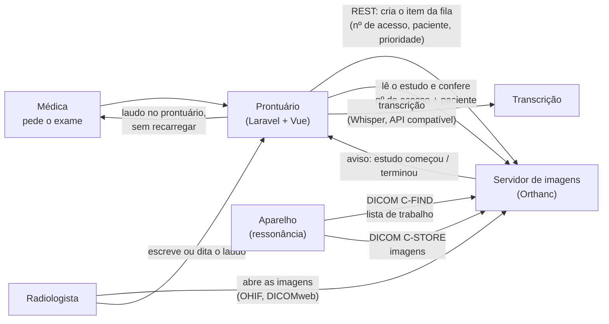
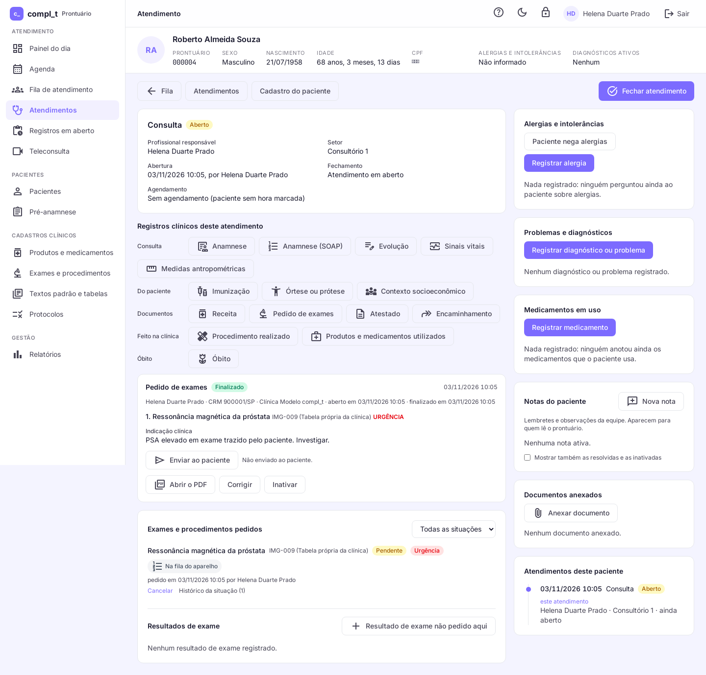
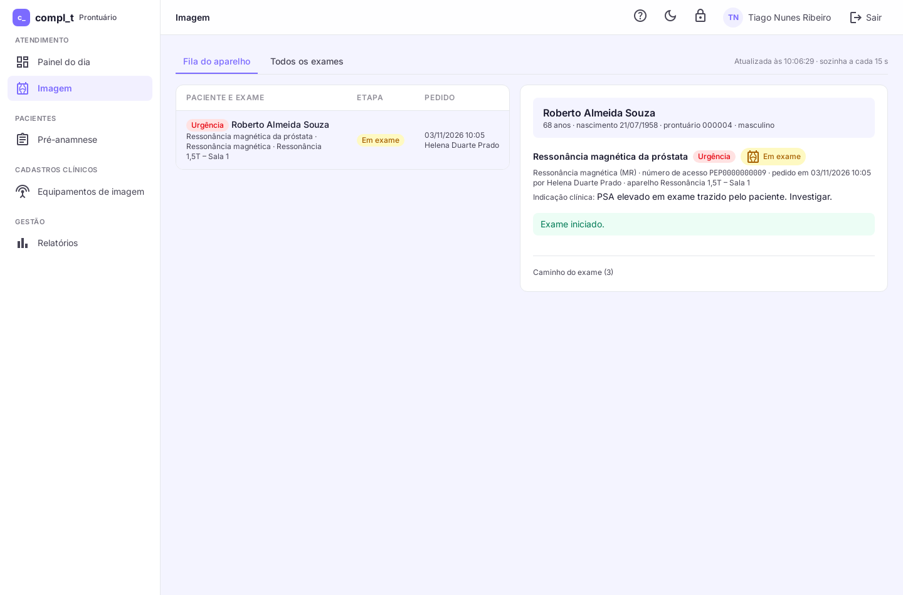
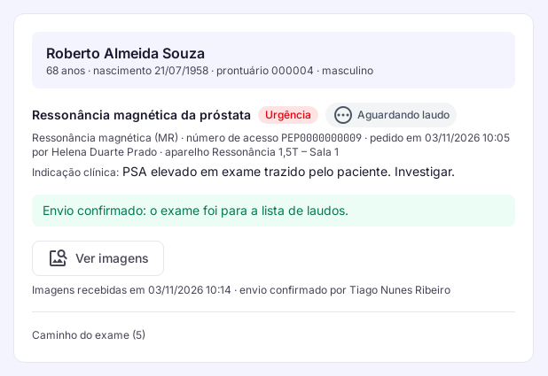
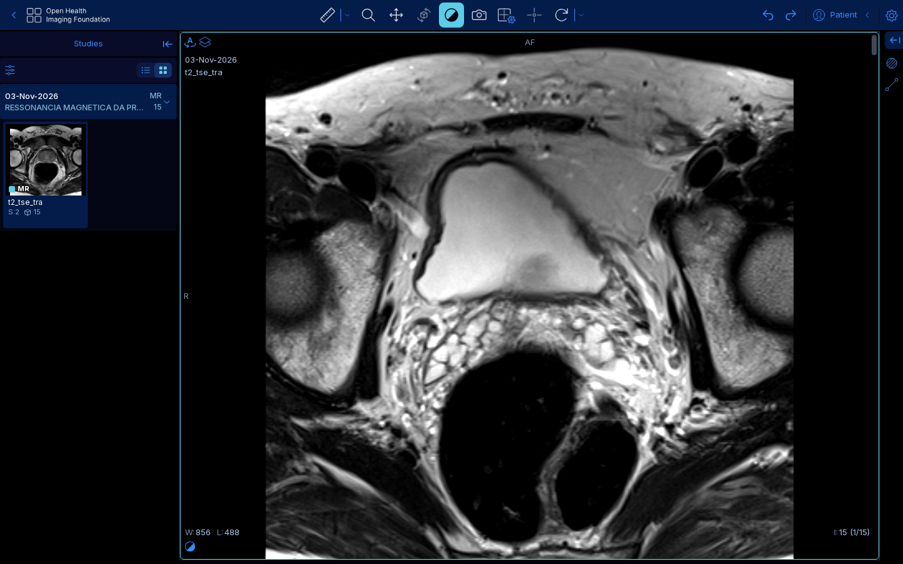
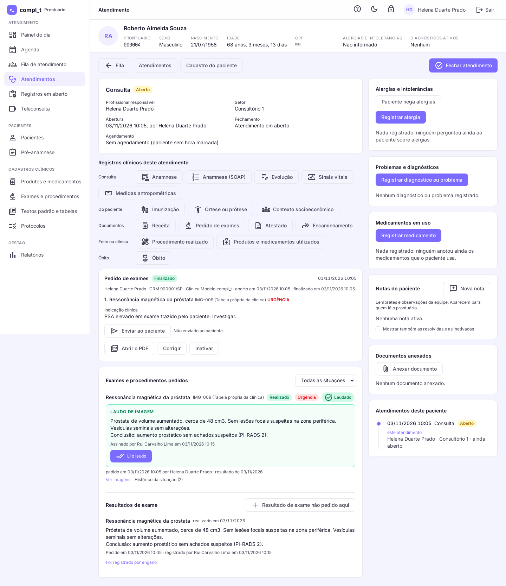

# Do pedido ao laudo: integração de imagem médica (DICOM) num prontuário

> Estudo de caso de engenharia de software, por **Filipe Lira**. O código é privado; aqui estão **as decisões, a segurança do paciente e os resultados**.
> Domínio: software para clínicas e hospitais (prontuário do paciente) ligado a aparelhos de imagem: ressonância, tomografia, raio-X, ultrassom. Tudo com dados fictícios e imagens públicas anonimizadas.

---

## Em uma frase

O pedido de exame feito no prontuário vai **sozinho** para a fila do aparelho, as imagens voltam ligadas ao pedido certo, o médico lauda no navegador **escrevendo ou ditando**, e quem pediu recebe o laudo no prontuário, sem ninguém redigitar nada.

## O problema

Em muitas clínicas, o prontuário e o sistema de imagem (PACS) não conversam:

- o pedido é **redigitado** no console do aparelho (nome, nascimento, exame), e cada redigitação é uma chance de trocar o paciente;
- a imagem e o laudo ficam em **outro sistema**, com outro login;
- quem pediu **telefona** para saber se o laudo saiu, o que é crítico na emergência.

## Meu papel

Tudo: arquitetura, integração DICOM, backend, frontend, infraestrutura (local e no servidor na nuvem), testes de ponta a ponta e o desenho das barreiras de segurança.

## Como funciona

| Peça | O que é |
|---|---|
| Prontuário | o sistema de origem: pedido, equipamentos, etapas do exame, laudo, auditoria |
| Servidor de imagens | Orthanc (código aberto): fila do aparelho (Modality Worklist), armazenamento, DICOMweb; índice no PostgreSQL |
| Visualizador | OHIF (código aberto, MIT), aberto já no exame, a partir do prontuário |
| Aparelho | simulado com DCMTK: consulta a fila e envia imagens reais de exemplo, como um aparelho de verdade |
| Transcrição | Whisper por uma interface no formato da API da OpenAI: trocar de serviço é trocar um endereço |

**Padrões usados:** DICOM (C-FIND de lista de trabalho, C-STORE, C-ECHO), DICOMweb (WADO-RS), fluxo no espírito do perfil IHE Scheduled Workflow. HL7 v2 / FHIR (ServiceRequest, ImagingStudy, DiagnosticReport) ficam como próximo passo para falar com sistemas de terceiros.

## Decisões de engenharia

| Decisão | Por quê |
|---|---|
| **A "pasta do pedido" é lógica: o número de acesso** | O pedido gera um número de acesso único que vai para a fila do aparelho e volta dentro de cada imagem. O prontuário acha "as imagens deste pedido" por ele. Nada de copiar arquivos para pastas: menos peças, menos carga, e escala com o armazenamento do servidor de imagens. |
| **Dupla checagem: número de acesso E paciente** | O aviso do servidor só diz "olhe este estudo". O prontuário lê o estudo e só liga a imagem ao pedido se os dois baterem. Imagem de outro paciente **não entra** e aparece em vermelho, à vista de todos. Nada é ligado por aproximação. |
| **Confirmação do técnico em vez do "estudo estável"** | O servidor de imagens só sabe que parou de receber imagens por alguns segundos. Uma pausa no meio do exame parece o fim. Por isso o laudo só começa quando o técnico confirma, vendo quantas séries e imagens chegaram. |
| **A IA nunca assina** | O laudo ditado vira rascunho marcado "transcrito, a conferir". Lado (direito/esquerdo), medidas e negações ("sem", "não") ficam destacados, que é onde a transcrição costuma errar. Só assina quem marca que conferiu. |
| **O prontuário é a fonte única dos equipamentos** | Cadastrar o aparelho no prontuário já o cadastra no servidor de imagens, na mesma operação. Com o servidor fora do ar, nada é gravado pela metade. Aparelho não cadastrado não envia imagem nem vê a fila. |
| **A etapa da imagem não muda a situação do exame** | O exame pedido segue as regras de sempre (pendente, realizado, cancelado). A imagem tem as etapas dela (na fila → em exame → imagens recebidas → aguardando laudo → em laudo → laudado → visto). O laudo assinado entra como resultado pelo caminho que já existia. Nada do que funcionava mudou. |
| **Comparação só com o mesmo paciente** | Ao laudar, o radiologista vê os exames de imagem anteriores do paciente (mesma modalidade primeiro, com o laudo assinado) e abre o atual e o anterior lado a lado. A lista sai do cadastro do paciente, nunca do nome, e o servidor confere de novo antes de abrir: exame de outro paciente é recusado. Rascunho de laudo antigo nunca aparece. |
| **Desligado de fábrica** | É um módulo. A clínica que não o liga não vê nenhuma tela nova, perfil novo ou permissão nova. |

## Segurança do paciente

- **Ninguém redigita o paciente:** nome, nascimento, sexo e exame vão do prontuário para o aparelho.
- **Paciente sempre à vista** antes de qualquer ação, em todas as telas do fluxo.
- **Urgência no topo** da fila do aparelho e da lista de laudos. A prioridade também vai para o aparelho (STAT).
- **Pedido cancelado sai da fila do aparelho.** Cancelado depois de o exame começar, as imagens ficam e o aviso aparece.
- **O técnico não vê o rascunho do laudo** e não assina. Cada pessoa vê a fila das modalidades habilitadas para ela. Na ultrassonografia, quem executa é o médico.
- **"Li o laudo":** quem pediu confirma a leitura, e o ciclo fecha à vista de todos.
- **Tudo auditado:** abrir a fila, o exame e as imagens; cada mudança de etapa tem histórico que não se apaga (gatilho no banco).

## Qualidade em números

| | |
|---|---|
| Testes automatizados do produto | **445** verdes, entre eles **10 cenários** do fluxo de imagem (caminho certo e caminhos errados) |
| Teste de ponta a ponta em navegador real | **38 conferências**, com o servidor de imagens e o aparelho simulado de verdade |
| Caminhos errados testados | paciente trocado no aparelho, número de acesso desconhecido, aviso sem a senha do servidor, pedido cancelado, servidor fora do ar, laudo ditado sem conferência, pessoa que não pediu marcando "visto", comparação com exame de outro paciente |
| Defeitos que só o navegador achou | 3, corrigidos antes da entrega |

## Telas (dados fictícios, capturadas no servidor na nuvem)

| 1. A médica pede; o exame vai sozinho para a fila | 2. O técnico vê a fila, sem redigitar nada |
|---|---|
|  |  |

| 3. As imagens chegam e o técnico confirma | 4. O radiologista abre as imagens no navegador |
|---|---|
|  |  |

| 5. Laudo assinado | 6. Quem pediu vê o laudo no prontuário e confirma a leitura |
|---|---|
|  |  |

A imagem com paciente trocado (recusada e à vista no topo da tela) está coberta pelos testes de navegador; não aparece aqui para não deixar o aviso no ambiente de demonstração.

**No servidor:** o visualizador abre pelo mesmo endereço do prontuário, com senha e **só leitura** (o servidor web só deixa passar consulta). Nenhuma porta do servidor de imagens fica aberta para a internet.

**Defeito achado ao subir para o servidor:** o servidor de imagens esquecia os aparelhos cadastrados quando reiniciava, e o aparelho passava a ser recusado. A falha era do lado seguro (recusa, nunca liga errado), mas pararia uma demonstração. Correção: o prontuário, que é a fonte única do cadastro, confere a cada minuto e cadastra de novo o que faltar. Provado reiniciando o servidor: voltou sozinho em menos de 90 segundos.

## Próximos passos para escala real

| Tema | Caminho |
|---|---|
| **Ponte na clínica** | um servidor de imagens pequeno dentro da clínica recebe dos aparelhos pela rede local e encaminha ao central. O aparelho não precisa de internet, e uma queda de link não para o exame. |
| **Armazenamento** | o mesmo servidor de imagens grava em armazenamento de objetos compatível com S3 (plugin oficial), com o índice no PostgreSQL. Várias instâncias atrás de um balanceador, sem mudar o prontuário. |
| **Rede** | VPN entre a clínica e o central, ou túnel só de saída. Imagem não trafega aberta. |
| **Integração com terceiros** | HL7 v2 (ORM/ORU) ou FHIR (ServiceRequest, ImagingStudy, DiagnosticReport) para quem já tem prontuário ou sistema de imagem. |
| **Autorização no visualizador** | o prontuário emite um token por exame; só quem pode ver aquele pedido abre as imagens. |
| **Transcrição** | Whisper rodando na própria infraestrutura, para o áudio não sair do país. |

**Conta de armazenamento (estimativa, para dimensionar):**

- **Premissa de tamanho:** uma imagem de ressonância de 512 × 512 pixels a 16 bits tem 512 × 512 × 2 bytes ≈ **0,5 MB** sem compressão. Um exame com ~1.000 imagens ≈ **0,5 GB**. A amostra usada aqui (15 imagens) deu 2,1 MB compactada.
- **Exemplo:** 100 ressonâncias por dia × 0,5 GB = 50 GB/dia ≈ **1,5 TB por mês ≈ 18 TB por ano**.
- **Preço de referência:** armazenamento de objetos da Hetzner, €6,49/mês com 1 TB incluso e cerca de **€6,47 por TB a mais por mês**, sem impostos (página oficial, consultada em 03/11/2026). Ao fim do primeiro ano, ~18 TB ≈ **€117/mês** só de armazenamento, crescendo com o tempo de guarda.
- **Tempo de guarda** das imagens e laudos: definido pela norma vigente e pelo contrato (a conferir com o jurídico antes de qualquer uso real).

## Antes de qualquer uso com paciente real

Este case roda só com dados fictícios. Para uso real: parecer jurídico (ANVISA sobre software como dispositivo médico, CFM sobre telerradiologia, LGPD), transcrição dentro do país, autorização por exame no visualizador, infraestrutura própria de imagem e revisão das licenças.

## Stack

PHP 8.3 · Laravel · PostgreSQL 16 · Vue 3 · TypeScript · Tailwind · Docker · Orthanc · OHIF · DCMTK · DICOM / DICOMweb · Whisper · PHPUnit · Playwright

## Licenças e créditos

- **Orthanc:** GPLv3+; plugins DICOMweb, PostgreSQL e Python: AGPLv3. Usados sem alteração, por REST e DICOM.
- **OHIF Viewer:** MIT.
- **Imagens de exemplo:** Litjens, Geert, Futterer, Jurgen, & Huisman, Henkjan. (2015). *Data From Prostate-3T*. The Cancer Imaging Archive. DOI: [10.7937/K9/TCIA.2015.QJTV5IL5](https://doi.org/10.7937/K9/TCIA.2015.QJTV5IL5). Licença [CC BY 3.0](https://creativecommons.org/licenses/by/3.0/). Os dados do paciente foram trocados pelos dados fictícios do pedido; as imagens não foram alteradas.

**Demonstração ao vivo:** sob pedido, numa conversa.

## Outros cases

[pep-case](https://github.com/filipelira1/pep-case) · [plataforma-case](https://github.com/filipelira1/plataforma-case) · [crm-case](https://github.com/filipelira1/crm-case) · [mermaid-case](https://github.com/filipelira1/mermaid-case)

---

*Sou **Filipe Lira**, engenheiro de software em São Paulo (ABC Paulista). [LinkedIn](https://www.linkedin.com/in/filipe-lira-a54217167) · [GitHub](https://github.com/filipelira1)*

