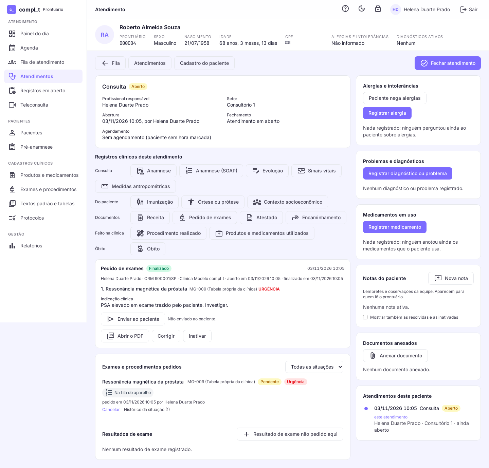
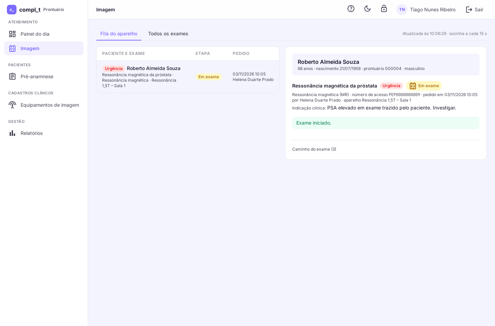
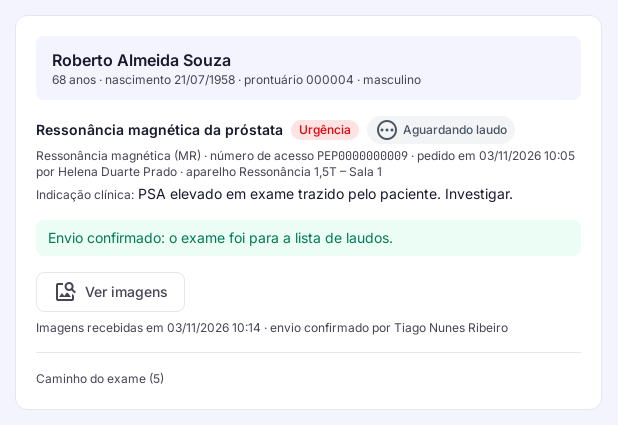
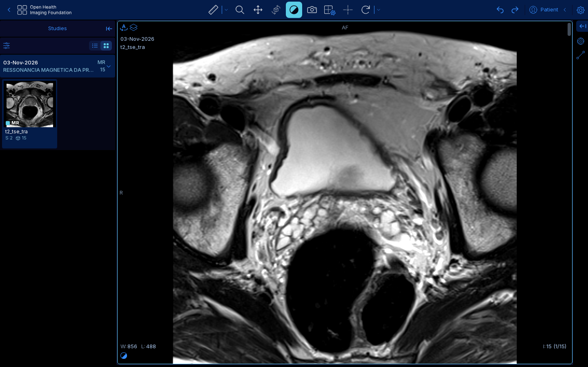
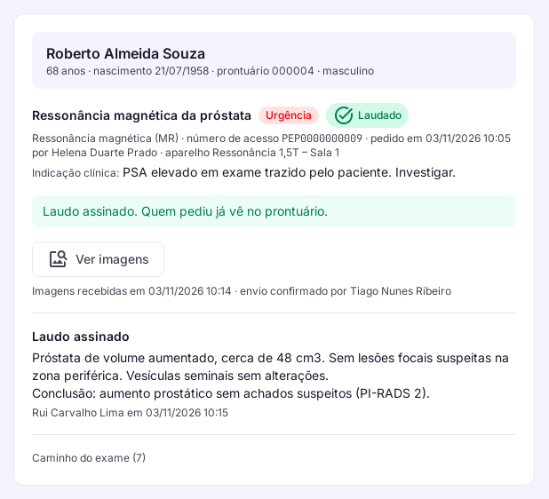
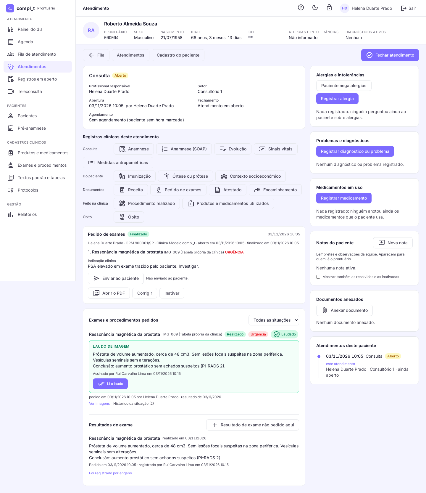

# Do pedido ao laudo, sem redigitar nada

> Imagem médica (ressonância, tomografia, raio-X, ultrassom) dentro do prontuário do paciente. Criado por **Filipe Lira**. Dados fictícios e imagens públicas anonimizadas.

**A médica pede o exame no prontuário. O pedido vai sozinho para o aparelho, as imagens voltam ligadas ao paciente certo, o radiologista lauda no navegador, escrevendo ou ditando, e quem pediu recebe o laudo no prontuário.**

## O problema

Em muitas clínicas, o prontuário e o sistema de imagem não conversam:

- o pedido é **redigitado** no aparelho (nome, nascimento, exame), e cada redigitação é uma chance de trocar o paciente;
- a imagem e o laudo ficam em **outro sistema**, com outro login;
- quem pediu **telefona** para saber se o laudo saiu, o que pesa na emergência.

## O que muda

| 1. A médica pede; o exame vai sozinho para a fila do aparelho | 2. O técnico vê a fila, com a urgência no topo |
|---|---|
|  |  |

| 3. As imagens chegam ligadas ao exame certo | 4. O radiologista abre as imagens no navegador |
|---|---|
|  |  |

| 5. Laudo escrito ou ditado, conferido e assinado | 6. Quem pediu lê o laudo no prontuário e confirma |
|---|---|
|  |  |

## Segurança do paciente

- **Ninguém redigita o paciente.** Nome, nascimento e exame vão do prontuário para o aparelho.
- **Imagem de outro paciente não entra.** É recusada e aparece em vermelho, à vista de todos.
- **A IA nunca assina.** O laudo ditado vira rascunho, com os pontos sensíveis em destaque. Só assina quem conferiu.
- **Comparação só com o mesmo paciente.** O radiologista vê os exames anteriores dele, lado a lado.
- **O ciclo fecha à vista:** quem pediu confirma que leu o laudo. Cada passo fica registrado, com quem fez e quando.

## Veja funcionando

- **Vídeo narrado do pedido ao laudo:** [complet.app.br/pep-demo](https://complet.app.br/pep-demo)
- **Demonstração ao vivo**, numa conversa: [complet.app.br](https://complet.app.br)

## Quem fez

Uma pessoa, do começo ao fim, como parte do [Prontuário Complet](https://github.com/filipelira1/pep-case).

Laravel · Vue · PostgreSQL · DICOM · Orthanc · OHIF

## Créditos

Imagens de exemplo: Litjens, Geert, Futterer, Jurgen, & Huisman, Henkjan. (2015). *Data From Prostate-3T*. The Cancer Imaging Archive. DOI: [10.7937/K9/TCIA.2015.QJTV5IL5](https://doi.org/10.7937/K9/TCIA.2015.QJTV5IL5). Licença [CC BY 3.0](https://creativecommons.org/licenses/by/3.0/). Os dados do paciente foram trocados por dados fictícios; as imagens não foram alteradas. Visualizador OHIF (MIT) e servidor Orthanc (GPLv3+), usados sem alteração.

## Outros cases

[pep-case](https://github.com/filipelira1/pep-case) · [atlas-case](https://github.com/filipelira1/atlas-case) · [crm-case](https://github.com/filipelira1/crm-case) · [plataforma-case](https://github.com/filipelira1/plataforma-case) · [mermaid-case](https://github.com/filipelira1/mermaid-case)

---

*Sou **Filipe Lira**, engenheiro de software em São Paulo (ABC Paulista). Quer integrar o seu sistema a outro que hoje não conversa com ele? [Fale comigo](https://complet.app.br/filipe/) · [LinkedIn](https://www.linkedin.com/in/filipe-lira-a54217167)*
